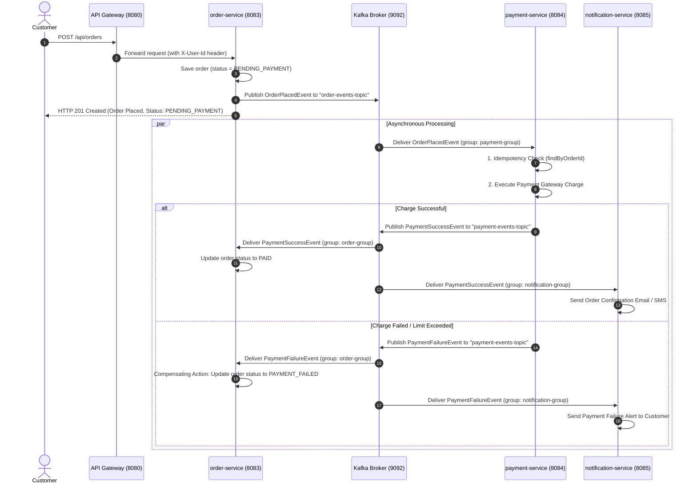
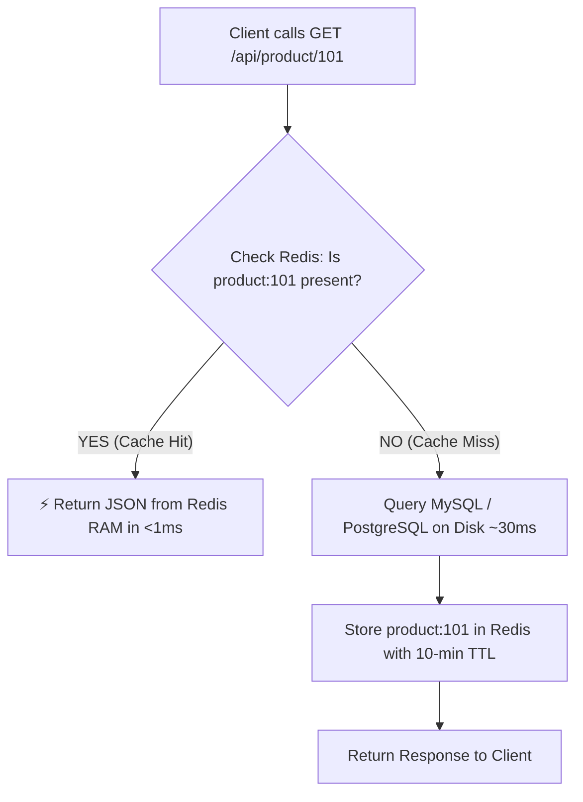
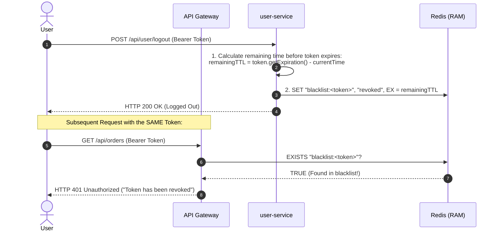

# Complete Microservices & Security Interview Master Guide
> **A Comprehensive Reference Guide for Microservices Architecture, Spring Cloud, Resilience, Security (CORS & JWT), and Interview Preparation.**

---

## Table of Contents
1. [Architecture Overview & System Design](#1-architecture-overview--system-design)
2. [Our Domain Services (What We Built)](#2-our-domain-services-what-we-built)
3. [Service Registry & Discovery (Netflix Eureka)](#3-service-registry--discovery-netflix-eureka)
4. [Inter-Service Communication (Spring Cloud OpenFeign)](#4-inter-service-communication-spring-cloud-openfeign)
5. [Client-Side Load Balancing (Spring Cloud LoadBalancer)](#5-client-side-load-balancing-spring-cloud-loadbalancer)
6. [Fault Tolerance & Circuit Breakers (Resilience4j)](#6-fault-tolerance--circuit-breakers-resilience4j)
7. [API Gateway (Spring Cloud Gateway)](#7-api-gateway-spring-cloud-gateway)
8. [Security Deep Dive: CORS & JWT Authentication](#8-security-deep-dive-cors--jwt-authentication)
9. [Event-Driven Architecture & Apache Kafka Deep Dive](#9-event-driven-architecture--apache-kafka-deep-dive)
10. [Distributed Caching & In-Memory Storage (Redis)](#10-distributed-caching--in-memory-storage-redis)
11. [Advanced Production Concepts (What Makes You a Senior Dev)](#11-advanced-production-concepts-what-makes-you-a-senior-dev)
12. [Top 30 High-Yield Interview Questions & Model Answers](#12-top-30-high-yield-interview-questions--model-answers)

---

## 1. Architecture Overview & System Design

In a monolithic architecture, everything (User, Product, Order, Payment) runs inside a single JVM process and shares a single database. If one module has a memory leak, the entire application crashes.

In our **Microservices Architecture**, each domain is an independent, independently deployable service with its own dedicated database (the **Database-per-Service pattern**):

```
                                    CLIENT (Web / Mobile / Postman)
                                                   │
                                                   ▼ (Port 8080)
                              ┌─────────────────────────────────────────┐
                              │           API GATEWAY (Port 8080)       │
                              │  - Single Entry Point                   │
                              │  - CORS Management                      │
                              │  - JWT Verification (The "Bouncer")     │
                              │  - Rate Limiting & Routing              │
                              └────────────────────┬────────────────────┘
                                                   │
                ┌──────────────────────────────────┼──────────────────────────────────┐
                ▼                                  ▼                                  ▼
      ┌───────────────────┐              ┌───────────────────┐              ┌───────────────────┐
      │   user-service    │              │  product-service  │              │   order-service   │
      │    (Port 8081)    │              │    (Port 8082)    │              │    (Port 8083)    │
      │  - User profiles  │              │  - Catalog/Price  │              │  - Creates Orders │
      │  - Auth / JWT     │              │  - Stock balance  │              │  - Calls Product  │
      └─────────┬─────────┘              └─────────┬─────────┘              └─────────┬─────────┘
                │                                  │                                  │
                │        OpenFeign Synchronous     │        OpenFeign Synchronous     │
                └──────────────◄───────────────────┴──────────────◄───────────────────┘
                                                   │
                                                   ▼ (Heartbeats & Registry)
                                  ┌─────────────────────────────────┐
                                  │   Eureka Discovery Server       │
                                  │          (Port 8761)            │
                                  │   - Service Registry            │
                                  │   - Dynamic IP & Port Tracking  │
                                  └─────────────────────────────────┘
                                                   │
                                     (Event-Driven / Asynchronous)
                                                   ▼
                                  ┌─────────────────────────────────┐
                                  │     Apache Kafka / RabbitMQ     │
                                  └────────────────┬────────────────┘
                                                   │
                         ┌─────────────────────────┴─────────────────────────┐
                         ▼                                                   ▼
              ┌─────────────────────┐                             ┌─────────────────────┐
              │   payment-service   │                             │ notification-service│
              │     (Port 8084)     │                             │     (Port 8085)     │
              │  - Process Charges  │                             │  - Emails / SMS     │
              └─────────────────────┘                             └─────────────────────┘
```

---

## 2. Our Domain Services (What We Built)

### 1. `user-service` (Port 8081)
* **Responsibility**: Manages user profiles, credentials, registration, and profile updates.
* **Core Entity**: `UserEntity` (`id`, `name`, `email`).
* **Endpoints**:
  * `POST /api/user/create` &rarr; Register a user.
  * `GET /api/user/get/{id}` &rarr; Fetch user by ID.
  * `GET /api/user/get` &rarr; Fetch all users.
  * `PUT /api/user/update/{id}` &rarr; Update profile.
  * `DELETE /api/user/delete/{id}` &rarr; Delete user.

### 2. `product-service` (Port 8082)
* **Responsibility**: Manages inventory catalog, pricing, and available stock.
* **Core Entity**: `ProductEntity` (`id`, `name`, `price`, `stock`).
* **Endpoints**:
  * `POST /api/product/create` &rarr; Add new product.
  * `GET /api/product/get/{id}` &rarr; Query price & stock.
  * `GET /api/product/get` &rarr; List products.
  * `PUT /api/product/update/{id}` &rarr; Update price/stock.
  * `DELETE /api/product/delete/{id}` &rarr; Remove product.

### 3. `order-service` (Port 8083)
* **Responsibility**: Connects User and Product to execute customer purchases, tracks order lifecycle, and initiates asynchronous event-driven payment processing.
* **Core Entity**: `OrderEntity` (`id`, `order_no`, `userId`, `productId`, `quantity`, `price`, `orderStatus`).
* **Key Collaboration**:
  * Calls `product-service` via **OpenFeign** to verify stock availability and fetch current unit price.
  * Calculates total price dynamically: `totalPrice = product.price * quantity`.
  * Saves order in initial state: `PENDING_PAYMENT`.
  * Emits `OrderPlacedEvent` asynchronously to Apache Kafka topic `order-events-topic`.
  * Listens to `payment-events-topic` via `PaymentEventConsumer` to update order status to `PAID` or `PAYMENT_FAILED`.

### 4. `payment-service` (Port 8084)
* **Responsibility**: Listens for order placements, performs idempotent transaction processing, and emits payment status events.
* **Core Entity**: `PaymentEntity` (`id`, `orderId`, `userId`, `amount`, `status`, `failureReason`).
* **Key Collaboration**:
  * Consumes `OrderPlacedEvent` from `order-events-topic` using Kafka consumer group `payment-group`.
  * **Idempotency Check**: Queries `paymentRepository.findByOrderId(orderId)` before processing to prevent double charges on duplicate Kafka delivery.
  * Executes payment gateway logic (with simulated timeouts and spending limits).
  * Emits `PaymentSuccessEvent` or `PaymentFailureEvent` to `payment-events-topic`.

### 5. `notification-service` (Port 8085)
* **Responsibility**: Asynchronously notifies customers via email, SMS, or push notifications upon key business milestones.
* **Key Collaboration**:
  * Consumes `PaymentSuccessEvent` and `PaymentFailureEvent` from `payment-events-topic`.
  * Processes alerts out-of-band without imposing latency or blocking checkout transactions.

---

## 3. Service Registry & Discovery (Netflix Eureka)

### What is it?
Eureka is the **Phonebook / Yellow Pages** of your microservices ecosystem. It consists of two components:
1. **Eureka Server**: A standalone application holding a registry table of all service names and their network locations (IP + Port).
2. **Eureka Client**: A dependency included in every microservice that registers itself upon startup and sends periodic heartbeats.

### Why is it needed?
* **Dynamic IP & Port Allocation**: In cloud environments (Kubernetes, AWS, Docker), containers frequently restart and receive dynamic IP addresses. You cannot hardcode `http://localhost:8082`.
* **Auto-Scaling**: If traffic spikes and you spin up 5 instances of `product-service`, Eureka automatically tracks all 5 instances.
* **Health Tracking**: Clients send a heartbeat every 30 seconds. If a service dies, Eureka evicts it from the registry so traffic isn't routed to a dead server.

### How it is Implemented:

#### Step 1: Create `discovery-service` (Eureka Server)
* **`pom.xml`**:
  ```xml
  <dependency>
      <groupId>org.springframework.cloud</groupId>
      <artifactId>spring-cloud-starter-netflix-eureka-server</artifactId>
  </dependency>
  ```
* **Main Class**:
  ```java
  @SpringBootApplication
  @EnableEurekaServer // <-- Activates Eureka Registry
  public class DiscoveryServiceApplication {
      public static void main(String[] args) {
          SpringApplication.run(DiscoveryServiceApplication.class, args);
      }
  }
  ```
* **`application.properties`**:
  ```properties
  server.port=8761
  spring.application.name=discovery-service

  # Don't register Eureka with itself:
  eureka.client.register-with-eureka=false
  eureka.client.fetch-registry=false
  ```

#### Step 2: Register Microservices as Eureka Clients
* **In each service's `pom.xml`**:
  ```xml
  <dependency>
      <groupId>org.springframework.cloud</groupId>
      <artifactId>spring-cloud-starter-netflix-eureka-client</artifactId>
  </dependency>
  ```
* **In each service's `application.properties`**:
  ```properties
  spring.application.name=product-service
  server.port=8082
  eureka.client.service-url.defaultZone=http://localhost:8761/eureka/
  ```

---

## 4. Inter-Service Communication (Spring Cloud OpenFeign)

### What is it?
OpenFeign is a **declarative HTTP client**. Instead of writing boilerplate code using `RestTemplate`, `HttpClient`, or `WebClient`, you define an interface annotated with Spring MVC annotations. Feign automatically generates the HTTP request execution at runtime.

### Why is it needed?
| Feature | `RestTemplate` | `WebClient` | `OpenFeign` |
| :--- | :--- | :--- | :--- |
| **Style** | Imperative / Manual | Reactive / Non-blocking | Declarative Interface |
| **Boilerplate** | High (build URLs, parse JSON) | Medium (reactive chains) | **Zero** (just an interface) |
| **Eureka Integration** | Manual config required | Supported | **Built-in natively** |
| **Load Balancing** | Requires `@LoadBalanced` | Requires config | **Automatic** |

### How it is Implemented:

#### In `order-service`:
1. **`pom.xml`**:
   ```xml
   <dependency>
       <groupId>org.springframework.cloud</groupId>
       <artifactId>spring-cloud-starter-openfeign</artifactId>
   </dependency>
   ```
2. **Main Application**:
   ```java
   @SpringBootApplication
   @EnableFeignClients // <-- Enables Feign scanning
   public class OrderServiceApplication { ... }
   ```
3. **Declare Client Interface**:
   ```java
   package com.example.order_service.client;

   import com.example.order_service.OrderDto.ProductResponseDto;
   import org.springframework.cloud.openfeign.FeignClient;
   import org.springframework.web.bind.annotation.GetMapping;
   import org.springframework.web.bind.annotation.PathVariable;

   // Name matches the spring.application.name in Eureka!
   @FeignClient(name = "product-service")
   public interface ProductClient {

       @GetMapping("/api/product/get/{id}")
       ProductResponseDto getProductById(@PathVariable("id") Long id);
   }
   ```
4. **Use in `OrderServiceImpl`**:
   ```java
   @Service
   public class OrderServiceImpl implements OrderService {
       private final OrderRepository orderRepository;
       private final ProductClient productClient;

       public OrderServiceImpl(OrderRepository orderRepository, ProductClient productClient) {
           this.orderRepository = orderRepository;
           this.productClient = productClient;
       }

       @Override
       public OrderResponseDto createOrder(OrderRequestDto order) {
           // Feign calls product-service over the network transparently!
           ProductResponseDto product = productClient.getProductById(order.getProductId());

           if (product.getStock() < order.getQuantity()) {
               throw new RuntimeException("Insufficient stock!");
           }
           ...
       }
   }
   ```

---

## 5. Client-Side Load Balancing (Spring Cloud LoadBalancer)

### What is it?
In traditional server-side load balancing (like NGINX or AWS ALB), the client sends a request to a proxy hardware/server, which then forwards it to one of the backend servers.

In **Client-Side Load Balancing** (Spring Cloud LoadBalancer):
* The client (`order-service`) asks Eureka for all available instances of `product-service`.
* Eureka returns a list: `[192.168.1.10:8082, 192.168.1.11:8082, 192.168.1.12:8082]`.
* **The client itself** decides which instance to call using an algorithm like **Round-Robin** or **Random**.

```
Request 1 ──► Instance A (Port 8082)
Request 2 ──► Instance B (Port 8086)
Request 3 ──► Instance C (Port 8087)
Request 4 ──► Instance A (Port 8082)
```

### Why is it needed?
* **No Single Point of Failure (SPOF)**: Eliminates an extra load-balancer hardware hop between internal microservices.
* **Lower Latency**: `order-service` connects directly to the target `product-service` instance.
* **Built Right into OpenFeign**: Spring Cloud automatically applies LoadBalancer to every `@FeignClient(name = "product-service")`.

---

## 6. Fault Tolerance & Circuit Breakers (Resilience4j)

### What is it?
A design pattern modeled after the electrical circuit breaker in your house. If a downstream microservice is down or unresponsive, the circuit breaker trips open to protect the calling service from crashing.

### The 3 Circuit Breaker States:

```
      [ 50% Failures Occur ]
   ┌───────────────────────────┐
   ▼                           │
┌──────────────┐         ┌────────────┐
│    CLOSED    │         │    OPEN    │
│ (Normal Ops) │         │ (Tripped!) │
└──────────────┘         └─────┬──────┘
   ▲                           │
   │  [ Trial Requests Pass ]  │ [ Sleep Window Expires ]
   └───────────┌───────────────┘
               ▼
        ┌─────────────┐
        │  HALF-OPEN  │
        └─────────────┘
```

1. **CLOSED (Normal)**: All requests flow directly to `product-service`. Everything is healthy.
2. **OPEN (Tripped)**: If failure rate exceeds a threshold (e.g. 50% errors over 10 calls), the circuit trips. For the next 30 seconds, **no network calls are made to `product-service`**. Requests immediately jump to the **Fallback Method**.
3. **HALF-OPEN (Testing)**: After the wait duration expires, the breaker lets a small number of trial requests through. If they succeed, it returns to **CLOSED**; if they fail, it resets back to **OPEN**.

### Why is it needed?
* **Prevents Cascading Failures**: When `product-service` hangs for 30s, threads in `order-service` pile up waiting. Without a circuit breaker, `order-service` exhausts its thread pool and crashes too.
* **Graceful Degradation**: Instead of showing an HTTP 500 error page, you return a helpful cached or fallback response.

### How it is Implemented:

1. **Add Dependency**:
   ```xml
   <dependency>
       <groupId>org.springframework.cloud</groupId>
       <artifactId>spring-cloud-starter-circuitbreaker-resilience4j</artifactId>
   </dependency>
   ```
2. **Apply `@CircuitBreaker` in Service**:
   ```java
   @CircuitBreaker(name = "productService", fallbackMethod = "productFallback")
   public ProductResponseDto fetchProductDetails(Long productId) {
       return productClient.getProductById(productId);
   }

   // Fallback must have identical return type and take Throwable as last parameter:
   public ProductResponseDto productFallback(Long productId, Throwable throwable) {
       ProductResponseDto fallback = new ProductResponseDto();
       fallback.setId(String.valueOf(productId));
       fallback.setName("Temporary Unavailable Product");
       fallback.setPrice(0.0);
       fallback.setStock(0);
       return fallback;
   }
   ```

---

## 7. API Gateway (Spring Cloud Gateway)

### What is it?
The **API Gateway** is the single entry point (reverse proxy) for all incoming client requests (React, Angular, iOS, Android, Postman). It sits between external clients and internal microservices.

### Why is it needed?
1. **Single Entry URL**: Clients only ever talk to port `8080`. They don't need to know or track 10 different ports.
2. **Centralized Security**: Inspect JWT tokens once at the gateway; reject unauthorized users before they touch backend services.
3. **CORS Centralization**: Solve browser cross-origin issues in one place.
4. **Rate Limiting & Throttling**: Block malicious IPs or restrict API abuse (e.g., max 100 requests/minute per user).
5. **Observability & Logging**: Log every incoming request and execution time in one central spot.

### How it is Implemented:

1. **`pom.xml`**:
   ```xml
   <dependency>
       <groupId>org.springframework.cloud</groupId>
       <artifactId>spring-cloud-starter-gateway</artifactId>
   </dependency>
   <dependency>
       <groupId>org.springframework.cloud</groupId>
       <artifactId>spring-cloud-starter-netflix-eureka-client</artifactId>
   </dependency>
   ```
2. **`application.yml`**:
   ```yaml
   server:
     port: 8080

   spring:
     application:
       name: api-gateway
     cloud:
       gateway:
         discovery:
           locator:
             enabled: true # Automatically discover services from Eureka
         routes:
           - id: user-service-route
             uri: lb://user-service       # 'lb://' uses client-side load balancer!
             predicates:
               - Path=/api/user/**

           - id: product-service-route
             uri: lb://product-service
             predicates:
               - Path=/api/product/**

           - id: order-service-route
             uri: lb://order-service
             predicates:
               - Path=/api/order/**
   ```

---

## 8. Security Deep Dive: CORS & JWT Authentication

### A. The CORS Headache Demystified

#### What is CORS?
Browsers enforce the **Same-Origin Policy**: code loaded from Origin A (`http://localhost:3000`) cannot access data from Origin B (`http://localhost:8081`) unless Origin B explicitly returns the header:
```http
Access-Control-Allow-Origin: http://localhost:3000
```

#### Why it's a Headache in Microservices:
Without an API Gateway:
* A modern browser sends an invisible pre-flight **`OPTIONS`** HTTP request before any `POST`, `PUT`, or `DELETE`.
* You must configure CORS beans in `user-service`, `product-service`, `order-service`, `payment-service`.
* Any discrepancy in headers (`Authorization`, `Content-Type`), credentials, or allowed origins causes client requests to fail silently in the browser.

#### The Gateway Solution (Solve it Once):
With an API Gateway, configure CORS in `api-gateway/application.yml`:
```yaml
spring:
  cloud:
    gateway:
      globalcors:
        cors-configurations:
          '[/**]':
            allowedOrigins: "http://localhost:3000"
            allowedMethods:
              - GET
              - POST
              - PUT
              - DELETE
              - OPTIONS
            allowedHeaders: "*"
            allowCredentials: true
```
All backend microservices run safely in your private network with zero CORS configuration required!

---

### B. JWT Authentication in Microservices

#### What is a JWT?
A JSON Web Token is a compact, URL-safe means of representing claims between two parties. It is composed of three base64-encoded strings separated by dots:
```
header.payload.signature
```

1. **Header (Metadata)**:
   ```json
   { "alg": "HS256", "typ": "JWT" }
   ```
   * *Base64Url Encoded*: `eyJhbGciOiJIUzI1NiIsInR5cCI6IkpXVCJ9`
   * *Note*: Readable by anyone; not encrypted.

2. **Payload (Claims / User Details)**:
   ```json
   {
     "sub": "suzain@gmail.com",
     "userId": 101,
     "role": "CUSTOMER",
     "exp": 1758299000
   }
   ```
   * *Base64Url Encoded*: `eyJzdWIiOiJzdXphaW5AZ21haWwuY29tIiwidXNlcklkIjoxMDEsInJvbGUiOiJDVVNUT01FUiIsImV4cCI6MTc1ODI5OTAwMH0`
   * *Note*: Readable by anyone. **Never store sensitive data (passwords, credit cards) here!**

3. **Signature (Cryptographic Seal)**:
   Calculated using HMAC-SHA256 hashing combining the Encoded Header, Encoded Payload, and the shared **Secret Key**:
   $$\text{Signature} = \text{HMAC-SHA256}\Big(\text{EncodedHeader} + \text{"."} + \text{EncodedPayload}, \ \text{SecretKey}\Big)$$
   * Result: `5dK8zL_9xM2v7QwRtYuIoP3kL...`

---

#### 5. End-to-End Chronological Lifecycle

```
+───────────────────────────────────────────────────────────────────────────────────────────+
│                               COMPLETE JWT LIFECYCLE                                      │
+───────────────────────────────────────────────────────────────────────────────────────────+

  [ PHASE 0: APPLICATION CONFIGURATION (Developer Setup) ]
  • Developer generates a 256-bit Secret Key once.
  • Configured in application.yml of user-service (for signing) and api-gateway (for verifying):
    jwt.secret: 404E635266556A586E3272357538782F413F4428472B4B6250645367566B5970
  • Remains identical across all users; secret to backend servers only.

  [ PHASE 1: ACCOUNT REGISTRATION ]
  Client ────────► POST /api/user/register { "name": "Suzain", "email": "...", "password": "123" }
                          │
                          ▼
                   [ user-service ]
                   • Hashes password via BCrypt: "123" ──► "$2a$10$92IXUN..."
                   • Stores record in user_db (id=101, email, hashed_password, role).
                   • (No JWT generated yet!)

  [ PHASE 2: LOGIN & TOKEN ISSUANCE ]
  Client ────────► POST /api/user/login { "email": "...", "password": "123" }
                          │
                          ▼
                   [ user-service ]
                   • Finds user by email in user_db.
                   • Validates password with passwordEncoder.matches().
                   • Builds Header + Payload { userId: 101, role: "CUSTOMER", exp: +24h }.
                   • Calculates Signature using Secret Key via HMAC-SHA256.
                   • Concatenates: Header.Payload.Signature
                          │
  Client ◄────────────────┴── Returns { "token": "eyJhbGciOi..." }

  [ PHASE 3: AUTHENTICATED REQUEST & GATEWAY VERIFICATION ]
  Client ────────► POST /api/order/create
                   Headers: [ Authorization: Bearer eyJhbGciOi... ]
                          │
                          ▼
                   [ API GATEWAY (AuthenticationFilter) ]
                   1. Intercepts request via RouteValidator (checks if route is secured).
                   2. Splits token into Header, Payload, and Signature.
                   3. Re-computes signature: HMAC-SHA256(Header + "." + Payload, SecretKey).
                   4. Compares Re-computed Signature == Token's Signature.
                      - If Mismatch: Rejects immediately (401 Unauthorized).
                      - If Tampered (hacker modified payload): Signature mismatch -> 401.
                   5. Checks expiration (exp > System.currentTimeMillis()).
                   6. Extracts claims (userId = 101, role = "CUSTOMER").
                   7. Mutates HTTP request by adding internal headers:
                      X-User-Id: 101
                      X-User-Role: CUSTOMER
                          │
                          ▼ (Routed downstream)
                   [ order-service / product-service ]
                   • Reads @RequestHeader("X-User-Id") Long userId directly!
                   • Zero authentication code, zero DB overhead, 100% secure.
```

---

#### 6. Code Implementations

##### A. `user-service` Token Generator (`JwtService.java`)
```java
@Component
public class JwtService {

    @Value("${jwt.secret}")
    private String secretKey;

    public String generateToken(Long userId, String email, String role) {
        Map<String, Object> claims = new HashMap<>();
        claims.put("userId", userId);
        claims.put("role", role);

        return Jwts.builder()
                .claims(claims)
                .subject(email)
                .issuedAt(new Date(System.currentTimeMillis()))
                .expiration(new Date(System.currentTimeMillis() + 1000 * 60 * 60 * 24)) // 24h validity
                .signWith(getSignKey(), Jwts.SIG.HS256)
                .compact();
    }

    private SecretKey getSignKey() {
        byte[] keyBytes = Decoders.BASE64.decode(secretKey);
        return Keys.hmacShaKeyFor(keyBytes);
    }
}
```

##### B. `api-gateway` Components (Route Validator, JwtUtil & Authentication Filter)

###### 1. `RouteValidator.java` (Determines which endpoints bypass authentication)
```java
package com.example.apigateway.filter;

import org.springframework.http.server.reactive.ServerHttpRequest;
import org.springframework.stereotype.Component;

import java.util.List;
import java.util.function.Predicate;

@Component
public class RouteValidator {

    // Whitelist of public endpoints that do NOT require a JWT token
    public static final List<String> openApiEndpoints = List.of(
            "/api/user/register",
            "/api/user/login",
            "/eureka"
    );

    // Predicate returns true if the incoming request is SECURED (not in the whitelist)
    public Predicate<ServerHttpRequest> isSecured =
            request -> openApiEndpoints
                    .stream()
                    .noneMatch(uri -> request.getURI().getPath().contains(uri));
}
```

###### 2. `JwtUtil.java` (Validates token and extracts claims in API Gateway)
```java
package com.example.apigateway.util;

import io.jsonwebtoken.Claims;
import io.jsonwebtoken.Jwts;
import io.jsonwebtoken.io.Decoders;
import io.jsonwebtoken.security.Keys;
import org.springframework.beans.factory.annotation.Value;
import org.springframework.stereotype.Component;

import javax.crypto.SecretKey;
import java.util.Date;

@Component
public class JwtUtil {

    // Must match the EXACT same secret key configured in user-service!
    @Value("${jwt.secret}")
    private String secretKey;

    // Decode secret key to HMAC-SHA SecretKey object
    private SecretKey getSignKey() {
        byte[] keyBytes = Decoders.BASE64.decode(secretKey);
        return Keys.hmacShaKeyFor(keyBytes);
    }

    // Extract all claims from token (validates signature and expiration automatically)
    public Claims extractAllClaims(String token) {
        return Jwts.parser()
                .verifyWith(getSignKey())
                .build()
                .parseSignedClaims(token)
                .getPayload();
    }

    // Check if token is expired
    public boolean isTokenExpired(String token) {
        return extractAllClaims(token).getExpiration().before(new Date());
    }

    // Validate token integrity
    public void validateToken(String token) {
        // Calling extractAllClaims validates the signature and expiration.
        // If expired or tampered, a JwtException is thrown.
        extractAllClaims(token);
    }
}
```

###### 3. `AuthenticationFilter.java` (The Gateway Bouncer)
```java
package com.example.apigateway.filter;

import com.example.apigateway.util.JwtUtil;
import io.jsonwebtoken.Claims;
import org.springframework.beans.factory.annotation.Autowired;
import org.springframework.cloud.gateway.filter.GatewayFilter;
import org.springframework.cloud.gateway.filter.factory.AbstractGatewayFilterFactory;
import org.springframework.http.HttpHeaders;
import org.springframework.http.HttpStatus;
import org.springframework.http.server.reactive.ServerHttpRequest;
import org.springframework.stereotype.Component;

@Component
public class AuthenticationFilter extends AbstractGatewayFilterFactory<AuthenticationFilter.Config> {

    @Autowired
    private RouteValidator validator;

    @Autowired
    private JwtUtil jwtUtil;

    public AuthenticationFilter() {
        super(Config.class);
    }

    // Configuration class required by Spring Cloud Gateway filter factory pattern
    public static class Config {}

    @Override
    public GatewayFilter apply(Config config) {
        return (exchange, chain) -> {
            ServerHttpRequest request = exchange.getRequest();

            // 1. Check if the incoming endpoint requires authentication
            if (validator.isSecured.test(request)) {

                // 2. Verify 'Authorization' header is present
                if (!request.getHeaders().containsKey(HttpHeaders.AUTHORIZATION)) {
                    exchange.getResponse().setStatusCode(HttpStatus.UNAUTHORIZED);
                    return exchange.getResponse().setComplete();
                }

                String authHeader = request.getHeaders().getFirst(HttpHeaders.AUTHORIZATION);

                // 3. Ensure header starts with "Bearer "
                if (authHeader == null || !authHeader.startsWith("Bearer ")) {
                    exchange.getResponse().setStatusCode(HttpStatus.UNAUTHORIZED);
                    return exchange.getResponse().setComplete();
                }

                // 4. Extract token string (skipping "Bearer ")
                String token = authHeader.substring(7);

                try {
                    // 5. Verify signature & expiration via secret key
                    Claims claims = jwtUtil.extractAllClaims(token);

                    // 6. Mutate request headers: inject user details for downstream microservices
                    ServerHttpRequest mutatedRequest = request.mutate()
                            .header("X-User-Id", String.valueOf(claims.get("userId")))
                            .header("X-User-Role", String.valueOf(claims.get("role")))
                            .header("X-User-Email", claims.getSubject())
                            .build();

                    // 7. Forward the mutated request downstream
                    return chain.filter(exchange.mutate().request(mutatedRequest).build());

                } catch (Exception e) {
                    // Token is invalid, expired, or tampered with
                    exchange.getResponse().setStatusCode(HttpStatus.UNAUTHORIZED);
                    return exchange.getResponse().setComplete();
                }
            }

            // If endpoint is public (e.g. login/register), pass request through untouched
            return chain.filter(exchange);
        };
    }
}
```

###### 4. `application.yml` in `api-gateway`
```yaml
server:
  port: 8080

spring:
  application:
    name: api-gateway
  cloud:
    gateway:
      discovery:
        locator:
          enabled: true
      routes:
        # User Service Route
        - id: user-service
          uri: lb://user-service
          predicates:
            - Path=/api/user/**

        # Order Service Route (Secured with AuthenticationFilter)
        - id: order-service
          uri: lb://order-service
          predicates:
            - Path=/api/order/**
          filters:
            - AuthenticationFilter

        # Product Service Route (Secured with AuthenticationFilter)
        - id: product-service
          uri: lb://product-service
          predicates:
            - Path=/api/product/**
          filters:
            - AuthenticationFilter

jwt:
  # Must match user-service jwt.secret exactly!
  secret: 404E635266556A586E3272357538782F413F4428472B4B6250645367566B5970
```

##### C. Downstream Services (`product-service` / `order-service`)
```java
@RestController
@RequestMapping("/api/orders")
public class OrderController {

    @PostMapping
    public ResponseEntity<OrderResponseDto> createOrder(
            @RequestHeader("X-User-Id") Long userId,
            @RequestBody OrderRequestDto requestDto) {
        // userId is verified and trusted directly from the Gateway!
        return new ResponseEntity<>(orderService.createOrder(userId, requestDto), HttpStatus.CREATED);
    }
}
```

---

#### 7. Security Best Practices for Production

1. **Environment Variables**: Never commit raw Secret Keys to Git repositories. Supply them dynamically at runtime:
   ```yaml
   jwt:
     secret: ${JWT_SECRET_KEY}
   ```
2. **Key Length**: Use at least 256-bit (64 hex characters) keys to prevent brute-force attacks.
3. **Token Expiration & Refresh Tokens**: Set short access token lifespans (15–60 mins) combined with rotating Refresh Tokens stored securely in HTTP-Only cookies.
4. **Asymmetric Signing (RS256)**: For multi-organization or large enterprise architectures, use a **Private Key** at `user-service` to sign tokens and a **Public Key** at `api-gateway` to verify them.

---

## 9. Event-Driven Architecture & Apache Kafka Deep Dive

### 1. Why Apache Kafka in Our Architecture?
In our ecosystem, `order-service` calls `product-service` **synchronously** using OpenFeign because the customer cannot place an order if inventory is unavailable. However, **payment and notifications must NOT block order placement**:
* **Temporal Decoupling**: If `payment-service` experiences a 5-second network hiccup or crashes, the customer's order is still saved safely.
* **Append-Only Disk Persistence**: Unlike traditional queues (e.g., RabbitMQ) that delete messages immediately upon consumption, Kafka retains all events on disk for a configurable retention window (`log.retention.hours = 168` by default, 7 days).
* **Multiple Independent Consumer Groups**: Both `payment-service` (`payment-group`) and `notification-service` (`notification-group`) can read from the same topic independently at their own processing speeds without interfering with each other.

---

### 2. The End-to-End Choreography Saga Flow



---

### 3. Kafka Core Primitives in Our Project

| Kafka Concept | Role in Our Architecture | Project Example |
| :--- | :--- | :--- |
| **Topic** | Logical stream / category for messages | `order-events-topic`, `payment-events-topic` |
| **Partition** | Ordered, immutable sequence of records on a broker disk | Topic partitions (e.g. 3 partitions for horizontal scaling) |
| **Record Key** | Determines which partition receives the message | `orderId.toString()` ensures all events for the same order stay strictly in-order |
| **Consumer Group** | A collection of consumer instances sharing topic partitions | `payment-group`, `order-group`, `notification-group` |
| **Consumer Offset** | Numerical index marking consumer progress in partition | Stored committed offset in Kafka internal topic `__consumer_offsets` |

---

### 4. Code Walkthrough & Implementation Details

#### A. Producer in `order-service`
1. **Dependencies (`pom.xml`)**:
   ```xml
   <dependency>
       <groupId>org.springframework.kafka</groupId>
       <artifactId>spring-kafka</artifactId>
   </dependency>
   ```

2. **Publishing the Event in `OrderServiceImpl.java`**:
   ```java
   // Save order with initial PENDING_PAYMENT status
   OrderEntity savedOrder = orderRepository.save(order);

   // Construct typed event
   OrderPlacedEvent event = OrderPlacedEvent.builder()
           .orderId(savedOrder.getId())
           .userId(savedOrder.getUserId())
           .quantity(savedOrder.getQuantity())
           .amount(BigDecimal.valueOf(savedOrder.getPrice()))
           .build();

   // Publish asynchronously using orderId as the partition key
   kafkaTemplate.send("order-events-topic", String.valueOf(savedOrder.getId()), event);
   ```

#### B. Consumer & Producer in `payment-service`
1. **Listening in `OrderEventConsumer.java`**:
   ```java
   @Component
   @RequiredArgsConstructor
   public class OrderEventConsumer {
       private final PaymentService paymentService;

       @KafkaListener(topics = "order-events-topic", groupId = "payment-group")
       public void consumeOrder(OrderPlacedEvent event) {
           paymentService.processPayment(event);
       }
   }
   ```

2. **Idempotent Processing in `PaymentServiceImpl.java`**:
   ```java
   @Service
   @RequiredArgsConstructor
   public class PaymentServiceImpl implements PaymentService {
       private final PaymentRepository paymentRepository;
       private final PaymentEventProducer producer;

       @Override
       public void processPayment(OrderPlacedEvent event) {
           // 1. Idempotency Check: Prevent duplicate charge on Kafka retry
           if (paymentRepository.findByOrderId(event.getOrderId()).isPresent()) {
               log.warn("Payment for Order ID: {} already exists. Skipping duplicate event.", event.getOrderId());
               return;
           }

           // 2. Persist initial payment record
           PaymentEntity payment = PaymentEntity.builder()
                   .orderId(event.getOrderId())
                   .userId(event.getUserId())
                   .amount(event.getAmount())
                   .status(PaymentStatus.PENDING)
                   .build();
           paymentRepository.save(payment);

           try {
               executeGatewayCharge(event);
               payment.setStatus(PaymentStatus.SUCCESS);
               paymentRepository.save(payment);

               producer.publishPaymentSuccessEvent(PaymentSuccessEvent.builder()
                       .orderId(event.getOrderId())
                       .paymentId(payment.getId())
                       .userId(event.getUserId())
                       .amount(event.getAmount())
                       .timestamp(LocalTime.now())
                       .build());
           } catch (Exception ex) {
               payment.setStatus(PaymentStatus.FAILED);
               payment.setFailureReason(ex.getMessage());
               paymentRepository.save(payment);

               producer.publishPaymentFailedEvent(PaymentFailureEvent.builder()
                       .orderId(event.getOrderId())
                       .paymentId(payment.getId())
                       .userId(event.getUserId())
                       .amount(event.getAmount())
                       .failureReason(ex.getMessage())
                       .timeStamp(LocalTime.now())
                       .build());
           }
       }
   }
   ```

#### C. Multi-Method Consumer in `order-service`
Using Spring Kafka's `@KafkaHandler`, `order-service` cleanly routes multiple event types arriving on the same topic:
```java
@Component
@RequiredArgsConstructor
@KafkaListener(topics = "payment-events-topic", groupId = "order-group")
public class PaymentEventConsumer {
    private final OrderRepository orderRepository;

    @KafkaHandler
    public void handlePaymentSuccess(PaymentSuccessEvent event) {
        updateOrderStatus(event.getOrderId(), "PAID");
    }

    @KafkaHandler
    public void handlePaymentFailure(PaymentFailureEvent event) {
        updateOrderStatus(event.getOrderId(), "PAYMENT_FAILED");
    }

    private void updateOrderStatus(Long orderId, String status) {
        orderRepository.findById(orderId).ifPresent(order -> {
            order.setOrderStatus(status);
            orderRepository.save(order);
        });
    }
}
```

---

### 5. Solving Cross-Service Type Mismatch (`spring.json.type.mapping`)

#### The Problem:
By default, Spring Kafka's `JsonSerializer` inserts the fully qualified Java class name in the record header (`__TypeId__ = "com.example.order_service.kafka.OrderPlacedEvent"`). When `payment-service` attempts to deserialize this header, it searches for that exact package path. Because microservices maintain independent codebases and package hierarchies, this throws a fatal **`ClassNotFoundException`** at runtime!

#### The Senior Fix (Decoupled Type Mapping):
Instead of hardcoding Java classpaths across services, configure a shared **logical token** in `application.properties`:

* **In `order-service`**:
  ```properties
  spring.kafka.producer.properties.spring.json.type.mapping=orderPlaced:com.example.order_service.kafka.OrderPlacedEvent
  spring.kafka.consumer.properties.spring.json.type.mapping=paymentSuccess:com.example.order_service.kafka.PaymentSuccessEvent,paymentFailure:com.example.order_service.kafka.PaymentFailureEvent
  ```
* **In `payment-service`**:
  ```properties
  spring.kafka.consumer.properties.spring.json.type.mapping=orderPlaced:com.example.payment_service.kafka.OrderPlacedEvent
  spring.kafka.producer.properties.spring.json.type.mapping=paymentSuccess:com.example.payment_service.kafka.PaymentSuccessEvent,paymentFailure:com.example.payment_service.kafka.PaymentFailureEvent
  ```

---

### 6. What Happens If `payment-service` Crashes? (The Definitive Interview Answer)

If an interviewer asks: *"You have Kafka between order-service and payment-service. What happens if payment-service crashes?"* — here is the exact architectural breakdown:

#### 1. The Message is NEVER Lost (Broker Durability)
* Kafka writes incoming messages to an append-only commit log on physical broker disk.
* Even if `payment-service` is completely dead, `order-service` continues accepting orders, emitting events, and functioning without degraded performance.
* Events wait securely inside the topic partition according to the broker retention policy (e.g. 7 days).

#### 2. Progress is Tracked via Consumer Offsets
* Kafka maintains consumer group progress in an internal compacted topic named `__consumer_offsets`.
* Every consumer group maintains its own independent offset pointer per partition:
  * **If crashed before reading the record**: The record offset is unconsumed. When `payment-service` reboots, it reads from where it left off and processes the event.
  * **If crashed while processing**: If the offset was not yet committed, Kafka re-delivers that exact message when the service restarts.

#### 3. The Duplicate Processing Hazard (Why Idempotency is Mandatory)
* Because Kafka provides **at-least-once delivery semantics** by default, re-delivering a message after a mid-flight crash means `payment-service` could charge the user twice.
* **The Safeguard**:
  1. A unique database index on `order_id` in the `payments` table.
  2. An idempotency check before charging: `if (paymentRepository.findByOrderId(event.getOrderId()).isPresent()) return;`

#### 4. Poison Pill Prevention & Dead Letter Topics (DLT)
* If the crash was caused by a malformed payload or a code bug that throws an unhandled runtime exception, rebooting the service will cause it to re-read the same message and crash again (**infinite crash loop**).
* **The Safeguard**: Use `ErrorHandlingDeserializer` combined with a **Dead Letter Topic (DLT)**:
  ```properties
  spring.kafka.consumer.value-deserializer=org.springframework.kafka.support.serializer.ErrorHandlingDeserializer
  spring.kafka.consumer.properties.spring.deserializer.value.delegate.class=org.springframework.kafka.support.serializer.JsonDeserializer
  ```
  If a record fails after configured retry backoffs, Spring Kafka automatically routes the corrupt record to a DLT (e.g. `order-events-topic.DLT`) and advances the offset, unblocking the consumer group.

#### 5. Long Outages & Order Expiration
* If `payment-service` remains offline for hours, orders in `order-service` sit in `PENDING_PAYMENT`.
* **The Safeguard**: A scheduled worker or Saga orchestrator queries orders older than 15 minutes in `PENDING_PAYMENT` and transitions them to `EXPIRED` or `CANCELLED`.

---

## 10. Distributed Caching & In-Memory Storage (Redis)

### 1. What is Redis & Why is it Mandatory in Microservices?
**Redis** (**RE**mote **DI**ctionary **S**erver) is an open-source, in-memory key-value data structure store. 

#### 🏢 The Real-World Storage Hierarchy:
* **Relational DB (PostgreSQL / MySQL)**: Data lives permanently on **Disk/SSD**. Queries require disk I/O, relational joins, and query plan execution (**Latency: 15–50 ms**).
* **Redis**: Data lives completely in **RAM**. Access is pure memory pointer retrieval (**Latency: < 1 ms**).

In our e-commerce platform, **over 90% of requests are read operations** (browsing catalog, viewing product details). If 10,000 concurrent customers view an iPhone 15 simultaneously, running `SELECT * FROM products WHERE id = 101` 10,000 times against MySQL will spike database CPU to 100% and choke disk I/O. With Redis:
* **Request #1**: Fetches from MySQL (~30 ms) and puts the result in Redis RAM.
* **Requests #2 to #10,000**: Served directly from Redis RAM in **< 1 ms** without touching the database!

---

### 2. The Cache-Aside (Lazy-Loading) Patter a

This is the industry-standard caching pattern implemented in `product-service`:



* **Cache Hit**: Data was found in Redis $\rightarrow$ instant response, DB spared.
* **Cache Miss**: Data not in Redis $\rightarrow$ read from DB, populate Redis for future callers, return response.

---

### 3. Cache Invalidation & Avoiding "Stale Data"

> **The Golden Rule**: *"There are only two hard things in Computer Science: cache invalidation and naming things."* — Phil Karlton

If an admin updates the iPhone price from $999 to $899 in MySQL, but Redis still holds $999, customers will see the wrong price (**Stale Data**).

#### A. Architecture Layering: Docker Container vs Spring Boot Application
> **Core Concept**: Running Redis in a Docker container (`docker run -p 6379:6379 redis`) only creates the external in-memory storage engine. It does **not** automatically connect to your Spring Boot application. 
> To connect Spring Boot with Redis, you must provide:
> 1. **Client Driver**: `spring-boot-starter-data-redis` (Lettuce connection driver) in `pom.xml`.
> 2. **Connection Properties**: `spring.data.redis.host=localhost` and `port=6379` in `application.properties`.
> 3. **The Master Switch**: `@EnableCaching` on your `@SpringBootApplication` or `@Configuration` class.

#### B. Why We Use Annotations: Spring AOP vs Manual Boilerplate
Without Spring's caching annotations, developers would have to manually write 15+ lines of repetitive code in *every single service method*:

```java
// ❌ WITHOUT ANNOTATIONS (Manual, repetitive boilerplate):
public ProductResponseDto getProductById(Long id) {
    String cacheKey = "product:" + id;
    ProductResponseDto cached = (ProductResponseDto) redisTemplate.opsForValue().get(cacheKey);
    if (cached != null) {
        return cached; // Cache Hit
    }
    ProductEntity entity = productRepository.findById(id).orElseThrow(...);
    ProductResponseDto dto = mapToDto(entity);
    redisTemplate.opsForValue().set(cacheKey, dto, 10, TimeUnit.MINUTES);
    return dto; // Cache Miss
}
```

```java
// ✅ WITH SPRING CACHING ANNOTATIONS (Declarative, clean, zero boilerplate):
@Cacheable(value = "products", key = "#id")
public ProductResponseDto getProductById(Long id) {
    return productRepository.findById(id).map(this::mapToDto).orElseThrow(...);
}
```
**Under the Hood (Spring AOP Proxy)**: When a method is annotated with `@Cacheable`, Spring creates a dynamic proxy around your service bean. When a caller invokes `getProductById(101)`, the call hits the proxy first. The proxy checks Redis: if present, it returns the cached object immediately without ever invoking your service method body or the database!

#### C. The Core Spring Boot Cache Annotations

| Annotation | Action | When to Use | Behind-the-Scenes Behavior |
| :--- | :--- | :--- | :--- |
| **`@EnableCaching`** | Master Switch | Main Application / Config class | Enables Spring's AOP post-processors to detect and proxy caching annotations across your beans. |
| **`@Cacheable`** | Read-through Cache | Read operations (`getById`) | Checks cache first. **Hit** $\rightarrow$ return cached data. **Miss** $\rightarrow$ execute method, store result in Redis, return data. |
| **`@CacheEvict`** | Cache Invalidation | Update & Delete operations | Removes one key (`key = "#id"`) or all keys (`allEntries = true`) from Redis to prevent serving **stale/outdated data**. |
| **`@CachePut`** | Cache Update | Forced refresh operations | **Always** executes the underlying method and updates Redis with the new result without skipping execution. |

#### D. Complete Service Implementation Example

```java
@Service
public class ProductServiceImpl implements ProductService {

    private final ProductRepository productRepository;

    public ProductServiceImpl(ProductRepository productRepository) {
        this.productRepository = productRepository;
    }

    // 1. CACHE-ASIDE READ: If in Redis, return it; else run method & save in Redis
    @Cacheable(value = "products", key = "#id")
    public ProductResponseDto getProductById(Long id) {
        log.info("Cache Miss! Querying PostgreSQL/MySQL on Disk for ID: {}", id);
        return productRepository.findById(id)
                .map(this::mapToDto)
                .orElseThrow(() -> new ResourceNotFoundException("Product not found"));
    }

    // 2. CACHE EVICTION ON UPDATE: Deletes stale product from Redis so next read gets fresh data
    @CacheEvict(value = "products", key = "#id")
    public ProductResponseDto updateProduct(Long id, ProductRequestDto dto) {
        log.info("Database Updated -> Evicting Redis Cache for ID: {}", id);
        ProductEntity entity = productRepository.findById(id).orElseThrow(...);
        entity.setPrice(dto.getPrice());
        return mapToDto(productRepository.save(entity));
    }

    // 3. CACHE EVICTION ON DELETE: Removes deleted item from cache
    @CacheEvict(value = "products", key = "#id")
    public void deleteProduct(Long id) {
        log.info("Product Deleted -> Evicting Redis Cache for ID: {}", id);
        productRepository.deleteById(id);
    }

    // 4. BULK CACHE EVICTION: Clears all cached products when catalog is refreshed in batch
    @CacheEvict(value = "products", allEntries = true)
    public void clearAllProductCache() {
        log.info("Evicting entire products cache namespace");
    }
}
```

#### E. Time-To-Live (TTL) & Memory Safeguards
RAM is finite and expensive. We must never let keys live in Redis indefinitely (risk of Out-Of-Memory / OOM crashes). We configure a default TTL in `RedisCacheConfiguration`:
```java
@Bean
public RedisCacheConfiguration cacheConfiguration() {
    return RedisCacheConfiguration.defaultCacheConfig()
            .entryTtl(Duration.ofMinutes(10)) // Auto-expire from RAM after 10 mins
            .disableCachingNullValues();
}
```

#### F. The Serialization Trap: Java Binary vs JSON Serialization
* **Default Behavior (JDK Serialization)**: By default, Spring uses `JdkSerializationRedisSerializer`. Cached objects look like raw binary garbage in Redis (`\xac\xed\x00\x05sr\x00...`). 
  * *Disadvantages*: Unreadable in `redis-cli`, breaks if class `serialVersionUID` changes, and cannot be read by other microservices written in Node.js, Go, or Python.
* **Production Best Practice (JSON Serialization)**: Use `GenericJackson2JsonRedisSerializer` so values are saved as human-readable JSON (`{"id": 101, "name": "iPhone 15", "price": 999.0}`).

```java
@Configuration
public class RedisConfig {

    @Bean
    public RedisCacheConfiguration cacheConfiguration() {
        return RedisCacheConfiguration.defaultCacheConfig()
                .entryTtl(Duration.ofMinutes(10))
                .disableCachingNullValues()
                .serializeValuesWith(RedisSerializationContext.SerializationPair
                        .fromSerializer(new GenericJackson2JsonRedisSerializer()));
    }
}
```

---

### 4. The Critical Interview Question: Why Store JWT in Redis After Logout?

#### The Problem: The Stateless Nature of JWTs
* In traditional session-based apps, the server holds a `sessions` table. To log out, the server simply deletes the session row.
* **JWT is 100% Stateless**: Once `user-service` signs and issues a JWT, **the server stores nothing**. The token is self-contained: it carries its own signature and expiration time (`exp`).
* When a user clicks **"Logout"**, the frontend can delete the token from `localStorage`. **BUT the token is still cryptographically valid until its expiration timestamp!**
* If an attacker intercepted the token (via public Wi-Fi, XSS, or browser history), the attacker can continue making valid API calls with `Authorization: Bearer <stolen_token>`. The Gateway will verify the signature and accept it!

```
                               THE LOGOUT DILEMMA:
                      
  User clicks LOGOUT               Attacker uses STOLEN TOKEN
          │                                   │
          ▼                                   ▼
Frontend deletes token             POST /api/orders (Bearer token)
  from localStorage                           │
                                              ▼
                                   API Gateway validates signature:
                                   "Signature is genuine! Expiration is valid!"
                                   ──► ⚠️ ATTACK SUCCEEDS!
```

#### The Solution: The Redis Token Blacklist Pattern
Since we cannot forcefully delete the token from an attacker's device, we store revoked tokens in a **Redis Blacklist** with a **dynamic TTL**:



#### Why is Redis Ideal for JWT Blacklisting?
1. **Ultra-Low Latency**: The API Gateway checks Redis on *every incoming request*. A Redis lookup takes **< 0.5 ms**, adding zero noticeable delay.
2. **Zero Memory Leaks (Self-Cleaning)**: By setting Redis `EX = remainingTTL`, as soon as the token expires naturally, Redis **automatically purges it from RAM**. You never accumulate old tokens in memory!

---

### 5. Other Advanced Redis Use Cases in Microservices

#### A. Distributed Rate Limiting (Token Bucket Algorithm)
At the `api-gateway`, Redis tracks request counters per IP address to block DDoS attacks:
```yaml
filters:
  - name: RequestRateLimiter
    args:
      redis-rate-limiter.replenishRate: 10   # 10 requests allowed per second
      redis-rate-limiter.burstCapacity: 20  # Max burst of 20 requests
```

#### B. Distributed Locks (Preventing Inventory Race Conditions)
If only **1 PlayStation 5 is left in stock** and 2 users click "Buy Now" at the exact same millisecond:
* If both check MySQL at the same time: `stock = 1` $\rightarrow$ both deduct stock $\rightarrow$ inventory drops to `-1` (**Overselling bug**).
* **Redis Distributed Lock (Redisson / `SETNX`)**:
  ```java
  RLock lock = redissonClient.getLock("product:lock:101");
  if (lock.tryLock(1, 5, TimeUnit.SECONDS)) {
      try {
          // Only ONE thread can execute stock deduction at a time!
          orderService.deductStock(productId, quantity);
      } finally {
          lock.unlock();
      }
  }
  ```

---

### 6. Summary Comparison: Database vs Redis vs Kafka

| Feature | PostgreSQL / MySQL | Redis | Apache Kafka |
| :--- | :--- | :--- | :--- |
| **Storage Medium** | Disk / SSD | **RAM (Memory)** | Disk (Sequential Append Log) |
| **Primary Purpose** | Permanent relational data | **Ultra-fast cache & state** | **Asynchronous event streaming** |
| **Latency** | 10–50 ms | **< 1 ms** | ~5–10 ms |
| **Query Capability** | Complex SQL, JOINs, ACID | Key-Value, Hashes, Sets | Consumer group offset stream |
| **Data Retention** | Permanent | Short-to-Medium (TTL) | Time-based (e.g. 7 days) |
| **Project Role** | Users, Orders, Payments | Product Cache, Blacklist, Rate limits | Inter-service Saga events |

---

## 11. Advanced Production Concepts (What Makes You a Senior Dev)

### 1. Distributed Tracing (Micrometer Tracing + Zipkin)
* **The Problem**: A request to `/api/order/create` fails with an HTTP 500 error. The request went through: `Gateway ──► Order ──► Product ──► Payment`. **Which service failed?**
* **The Solution**:
  * **`TraceId`**: A single ID assigned to the request at the Gateway and propagated to every service in HTTP headers (`traceparent`).
  * **`SpanId`**: Represents an individual hop or work unit within a service.
  * **Zipkin Dashboard**: Paste the `TraceI
  d` and see a timeline showing the exact failure line and duration of every service.

### 2. Centralized Configuration (Spring Cloud Config Server)
* **The Problem**: Changing a database URL, logging level, or secret key across 10 microservices requires rebuilding and redeploying 10 JAR files.
* **The Solution**: Store all `application.yml` files in a centralized Git repo. A `config-server` serves these configurations dynamically. Using `@RefreshScope`, services update their configuration on the fly without restarting!

### 3. Event-Driven Messaging vs REST
* **Synchronous (OpenFeign)**: Used when the caller **needs the response immediately to make a decision** (e.g. `order-service` checking product stock).
* **Asynchronous (Kafka)**: Used when the caller **doesn't need to wait** (e.g. processing payment, sending an email, or generating an invoice PDF).

### 4. Distributed Transactions: The Saga Pattern
* **The Problem**: You cannot use `@Transactional` across three separate databases (`order-db`, `product-db`, `payment-db`).
* **The Solution (Compensating Transactions)**:
  1. `order-service` creates order in status `"PENDING_PAYMENT"`.
  2. `payment-service` tries to charge credit card.
  3. If payment fails: It publishes `PaymentFailureEvent`.
  4. `order-service` catches event and runs a **Compensating Transaction**: sets order status to `"PAYMENT_FAILED"` and releases inventory.

---

## 12. Top 30 High-Yield Interview Questions & Model Answers

#### Q1: What is the difference between a Monolith and a Microservices Architecture?
> **Answer**: A monolith bundles UI, business logic, and database access into a single deployable artifact sharing one database. Microservices decompose an application into small, autonomous, loosely coupled services organized around business capabilities, each maintaining its own database and communicating via lightweight protocols (REST or messaging).

#### Q2: What is the "Database-per-Service" pattern and why is it mandatory?
> **Answer**: Each microservice must own its private database. Other services can only access this data through public APIs. This ensures loose coupling, allows independent schema migrations, and prevents one service's query locks from impacting other services.

#### Q3: How does Eureka Service Discovery work?
> **Answer**: Services register with Eureka Server on startup by providing their application name and network coordinates (IP/port). They send heartbeats every 30 seconds to maintain registration. When Service A needs to call Service B, it fetches Service B's instance list from Eureka and caches it locally.

#### Q4: What happens if Eureka Server goes down?
> **Answer**: Microservices cache the registry locally. Even if Eureka goes down, services can continue communicating with each other using their cached IP lists. However, newly spawned instances cannot register until Eureka recovers.

#### Q5: What is Eureka "Self-Preservation Mode"?
> **Answer**: If Eureka Server suddenly stops receiving heartbeats from more than 15% of instances (often due to a network glitch, not actual service failure), it enters Self-Preservation mode. It stops evicting instances from the registry to prevent wiping out healthy services during a transient network partition.

#### Q6: Why use OpenFeign instead of RestTemplate or WebClient?
> **Answer**: OpenFeign is declarative: you write only a Java interface with annotations, eliminating HTTP client boilerplate. It integrates out-of-the-box with Eureka for service discovery and Spring Cloud LoadBalancer for round-robin load balancing.

#### Q7: What is the difference between Client-Side and Server-Side Load Balancing?
> **Answer**: In server-side load balancing (e.g. AWS ALB/NGINX), requests pass through a centralized proxy server. In client-side load balancing (Spring Cloud LoadBalancer), the calling service fetches the list of available instances from Eureka and directly picks one using an algorithm like Round-Robin, eliminating a middleman hop.

#### Q8: What is a Circuit Breaker and what problem does it solve?
> **Answer**: It prevents cascading failures. If downstream Service B fails or experiences extreme latency, the circuit breaker trips from CLOSED to OPEN. Subsequent calls fail immediately or invoke a fallback method without waiting for a timeout, preserving caller threads and resources.

#### Q9: Explain the states of a Circuit Breaker in Resilience4j.
> **Answer**:
> * **CLOSED**: Normal state; requests flow to downstream service.
> * **OPEN**: Failure threshold exceeded; requests fail immediately to fallback.
> * **HALF-OPEN**: Wait duration expires; a limited number of trial calls test if the downstream service has recovered.

#### Q10: What is an API Gateway and why is it essential?
> **Answer**: An API Gateway acts as the single reverse proxy front door for external clients. It handles cross-cutting concerns: dynamic routing to internal services via Eureka, SSL termination, CORS, rate limiting, and centralized JWT authentication.

#### Q11: How do you handle CORS in a Microservices architecture?
> **Answer**: Instead of configuring CORS in every downstream service, handle it globally at the API Gateway using Spring Cloud Gateway's `globalcors` configuration. The Gateway handles the pre-flight `OPTIONS` requests and attaches `Access-Control-Allow-*` headers.

#### Q12: How does JWT authentication work with an API Gateway?
> **Answer**: The client logs in through the `user-service` and receives a signed JWT. On subsequent requests, the client passes `Authorization: Bearer <token>` to the API Gateway. The Gateway's security filter validates the signature and expiration, extracts user claims (like `userId`), and forwards the request to downstream services with an internal header (`X-User-Id`).

#### Q13: Why shouldn't internal microservices verify passwords or database sessions?
> **Answer**: Verifying credentials in every service introduces tight coupling, duplicates security code, and creates massive database bottlenecks. Decoupling auth at the Gateway keeps domain services stateless and focused purely on business logic.

#### Q14: When should you use Synchronous vs Asynchronous communication?
> **Answer**:
> * **Synchronous (REST / Feign)**: When the caller cannot proceed without the immediate response (e.g., `order-service` verifying stock with `product-service`).
> * **Asynchronous (Kafka / RabbitMQ)**: When the caller does not depend on immediate execution (e.g., sending emails, analytics tracking, generating PDFs).

#### Q15: Why can't we use `@Transactional` across microservices?
> **Answer**: `@Transactional` relies on local database ACID transactions (or 2-Phase Commit protocols) bound to a single database connection. In microservices, each service has its own independent database, meaning transactions cannot span across process boundaries.

#### Q16: What is the Saga Pattern?
> **Answer**: A sequence of local transactions where each microservice updates its own database and publishes an event. If a step fails, the Saga executes **Compensating Transactions** backward to undo previous changes (e.g., cancelling an order if payment fails).

#### Q17: What is the difference between Choreography and Orchestration Saga?
> **Answer**:
> * **Choreography**: Event-driven; each service listens to events and decides when to act without a central coordinator.
> * **Orchestration**: A central Saga Orchestrator service tells each participant service what local transaction to execute.

#### Q18: What is Distributed Tracing and what are Trace IDs and Span IDs?
> **Answer**: Distributed tracing tracks the complete lifecycle of a request as it hops across multiple microservices. A **TraceId** uniquely identifies the entire end-to-end transaction. A **SpanId** identifies work done within a specific microservice hop. Tools like Zipkin visualize this call tree.

#### Q19: What is Spring Cloud Config Server?
> **Answer**: A centralized configuration management server that stores environment-specific configuration files in a version-controlled repository (like Git). Microservices fetch their properties at startup, and `@RefreshScope` enables updating configurations without redeployment.

#### Q20: How do you handle database migrations across microservices?
> **Answer**: Use migration tools like **Flyway** or **Liquibase** embedded within each microservice project. When a service boots up, it automatically applies versioned SQL migration scripts to its own database schema independently.

#### Q21: What happens if payment-service crashes while processing a Kafka message?
> **Answer**: 
> 1. **Message Durability**: The event remains safely persisted on Kafka broker disk.
> 2. **Offset Tracking**: Because the crash occurred before the offset was committed, Kafka recognizes the consumer went offline (via missed heartbeats to the Consumer Group Coordinator).
> 3. **Rebalance & Re-Delivery**: When the service restarts (or another consumer instance takes over), Kafka re-delivers the uncommitted event.
> 4. **Idempotency Defense**: The consumer must check `findByOrderId()` or rely on a DB unique constraint to guarantee the card isn't charged twice.

#### Q22: What is Idempotency in a Kafka Consumer and how do you achieve it?
> **Answer**: An idempotent consumer ensures that processing the exact same event multiple times yields the same result without unintended side effects (like charging a credit card twice). In our architecture, we achieve this by checking whether a payment record for the incoming `orderId` already exists in the database. If present, the consumer logs a warning and exits safely.

#### Q23: How do you avoid `ClassNotFoundException` when sharing JSON events between separate microservices?
> **Answer**: By default, Spring Kafka's `JsonSerializer` inserts the producer's fully-qualified class name into the `__TypeId__` header. In separate microservices with different package structures, deserialization fails. We resolve this by configuring `spring.json.type.mapping` in `application.properties` of both services to map arbitrary logical identifiers (e.g. `orderPlaced`) to each service's local event class.

#### Q24: What is a Poison Pill in Kafka and how do you prevent an infinite restart loop?
> **Answer**: A poison pill is a corrupted or incompatible message that repeatedly fails deserialization or causes an unhandled runtime exception. In a standard setup, Kafka retries indefinitely, locking the partition. We resolve this by configuring Spring Kafka's `ErrorHandlingDeserializer` wrapping `JsonDeserializer` and configuring a `DeadLetterPublishingRecoverer` to route failed messages to a Dead Letter Topic (DLT) after a set number of attempts.

#### Q25: What is the difference between Auto-Commit and Manual Acknowledgment in Spring Kafka?
> **Answer**: With auto-commit (`enable.auto.commit = true`), Kafka periodically commits offsets regardless of whether the business transaction succeeded. If the service crashes mid-processing, the message may be lost forever. With manual acknowledgment (`AckMode.MANUAL_IMMEDIATE` or `AckMode.RECORD`), offsets are only committed to `__consumer_offsets` after the local database transaction and external calls finish successfully.

#### Q26: Why is a JWT token stored in Redis after a user logs out?
> **Answer**: JWTs are inherently stateless; the server does not store active session records. When a user logs out, the client discards the token, but the token itself remains cryptographically valid until its expiration timestamp (`exp`). If an attacker stole that token, they could continue making requests. To revoke it, the backend stores the token in Redis with a TTL equal to its remaining lifespan. The API Gateway checks this Redis blacklist on every request. Once the token expires naturally, Redis auto-evicts it, preventing memory leaks.

#### Q27: What is the Cache-Aside pattern, and what is the difference between a Cache Hit and a Cache Miss?
> **Answer**: In Cache-Aside (Lazy Loading), the application checks the cache first before querying the primary database. A **Cache Hit** occurs when the requested key exists in Redis, returning the value in <1 ms without touching the database. A **Cache Miss** occurs when the key is absent; the application queries the database, writes the result to Redis with a TTL, and returns the response.

#### Q28: How do you prevent stale data in Redis (Cache Invalidation)?
> **Answer**: By using Spring's `@CacheEvict` annotation on update/delete endpoints. When a product's price or stock is updated, `@CacheEvict(value = "products", key = "#id")` immediately removes the outdated entry from Redis. The next read operation results in a cache miss and refreshes Redis with current database values. Additionally, setting a reasonable TTL (e.g. 10 minutes) ensures data eventually self-corrects even if an eviction event was missed.

#### Q29: What are Cache Penetration, Cache Breakdown, and Cache Avalanche, and how do you prevent them?
> **Answer**:
> * **Cache Penetration**: Queries for keys that do not exist in either Redis or the DB (e.g., malicious requests with `id = -9999`), causing every request to hit the DB. *Fix*: Cache `null` values with a short TTL, or use a Bloom Filter.
> * **Cache Breakdown**: A single "hot" key with massive concurrent traffic expires, causing thousands of requests to hit the DB simultaneously. *Fix*: Use a Redis distributed mutex lock to let only one thread rebuild the cache while others wait.
> * **Cache Avalanche**: A large number of cached keys expire at the exact same second, overwhelming the DB. *Fix*: Add random jitter/offsets (e.g., TTL = 10 mins ± 2 mins) so expirations are evenly staggered.

#### Q30: What is a Distributed Lock in Redis and when would you use it in microservices?
> **Answer**: In distributed systems where multiple service instances run concurrently, local Java locks (`synchronized`, `ReentrantLock`) only synchronize threads within a single JVM. A Redis Distributed Lock (using `SETNX` or Redisson) creates a shared lock across all service instances. This is vital in e-commerce to prevent inventory race conditions (e.g., two users purchasing the last available item at the exact same millisecond).

#### Q31: What is the difference between `@Cacheable` and `@CachePut` in Spring?
> **Answer**: `@Cacheable` checks the cache first (Cache-Aside pattern). If the key exists, it skips method execution entirely and returns the cached value. If absent, it runs the method and caches the result. In contrast, `@CachePut` **always executes the method body** and unconditionally updates the cache with the method's return value. It is typically used for update operations where you want to keep the cache continuously warmed without waiting for the next read miss.

#### Q32: Why should you configure JSON serialization (`GenericJackson2JsonRedisSerializer`) instead of default Java serialization in Redis?
> **Answer**: By default, Spring uses `JdkSerializationRedisSerializer`, which encodes Java objects into raw binary byte streams (`\xac\xed\x00\x05...`). This causes three major issues: (1) it is completely unreadable and difficult to debug in `redis-cli`, (2) any modification to the Java class or `serialVersionUID` triggers `SerializationException`, and (3) other microservices written in different languages (Python, Go, Node.js) cannot read the cached binary data. JSON serialization solves all three by storing language-agnostic, human-readable JSON payloads.

#### Q33: Does running a Redis container in Docker automatically connect it to Spring Boot?
> **Answer**: No. Docker merely hosts and runs the standalone Redis server process on port `6379`. For Spring Boot to utilize Redis, three application-level components are mandatory: (1) `spring-boot-starter-data-redis` dependency (providing the Lettuce connection client), (2) connection configuration in `application.properties` (`spring.data.redis.host` and `port`), and (3) the `@EnableCaching` annotation to activate Spring's AOP caching interceptor proxies.

---

### Quick Architecture Cheat-Sheet

| Component | Default Port | Primary Dependency | Key Annotation |
| :--- | :---: | :--- | :--- |
| **Eureka Server** | `8761` | `spring-cloud-starter-netflix-eureka-server` | `@EnableEurekaServer` |
| **API Gateway** | `8080` | `spring-cloud-starter-gateway` | *(Config-driven routes & filters)* |
| **User Service** | `8081` | `spring-cloud-starter-netflix-eureka-client` | `@SpringBootApplication` |
| **Product Service** | `8082` | `spring-cloud-starter-netflix-eureka-client`, `spring-boot-starter-data-redis` | `@SpringBootApplication`, `@Cacheable` |
| **Order Service** | `8083` | `spring-cloud-starter-openfeign`, `spring-kafka` | `@EnableFeignClients`, `@KafkaListener` |
| **Payment Service** | `8084` | `spring-kafka`, `spring-boot-starter-data-jpa` | `@KafkaListener`, `@Component` |
| **Notification Service** | `8085` | `spring-kafka` | `@KafkaListener` |
| **Redis Cache** | `6379` | `spring-boot-starter-data-redis` | `@EnableCaching`, `@CacheEvict` |
| **Kafka Broker** | `9092` | `org.apache.kafka` (Broker) | *(Topic partitions & commit log)* |
| **Circuit Breaker** | N/A | `spring-cloud-starter-circuitbreaker-resilience4j` | `@CircuitBreaker` |

