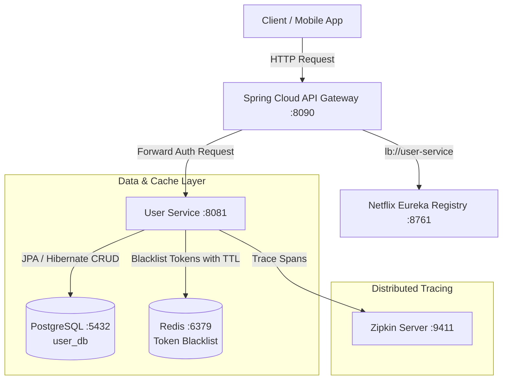

# 👤 User Service — ChaloKharido Microservices Platform

[](https://www.oracle.com/java/)
[](https://spring.io/projects/spring-boot)
[](https://www.postgresql.org/)
[](https://redis.io/)
[](https://www.docker.com/)
[](LICENSE)

A core identity, authentication, and user profile management microservice engineered for the **ChaloKharido** e-commerce ecosystem. Built with **Spring Boot 3**, **PostgreSQL**, **Redis**, and **Spring Security**, implementing **Stateless JWTs** with **Dynamic-TTL Token Revocation**.

---

## 🌟 Key Architectural Features

- **🔐 Stateless JWT Authentication**: Issues cryptographically signed JSON Web Tokens (`io.jsonwebtoken 0.12.6`) containing user claims (`id`, `role`, `email`).
- **🚫 Redis Dynamic-TTL Token Blacklist**: Overcomes the classic limitation of stateless JWTs by blacklisting revoked tokens in Redis on `/logout`. Key TTL is dynamically calculated to match the remaining token lifetime, preventing memory leaks.
- **🛡️ BCrypt Password Hashing**: Utilizes `spring-security-crypto` with salted BCrypt hashing for secure credential storage.
- **📦 Database-per-Service Pattern**: Uses an isolated PostgreSQL database (`user_db`) to guarantee loose coupling from product, order, and payment services.
- **🔍 Service Discovery (Eureka Client)**: Registers dynamically with **Netflix Eureka Server** on port `8761` for client-side load balancing via OpenFeign and Spring Cloud API Gateway.
- **📊 Distributed Tracing & Observability**: Integrated with **Micrometer Tracing**, **Zipkin**, and **Spring Boot Actuator** to trace inter-service latencies across distributed request paths.
- **🐳 Containerized Deployment**: Packaged as a lightweight container using **Eclipse Temurin 17 Alpine JRE**.

---

## 🏗️ Architecture Overview



---

## 🛠️ Tech Stack & Dependencies

| Category | Technology |
| :--- | :--- |
| **Language & Runtime** | Java 17 (OpenJDK / Eclipse Temurin) |
| **Core Framework** | Spring Boot 3.3.3, Spring Web, Spring Validation |
| **Security & Auth** | Spring Security Crypto, JJWT (`jjwt-api`, `jjwt-impl`, `jjwt-jackson` 0.12.6) |
| **Database & ORM** | PostgreSQL 15+, Spring Data JPA, Hibernate |
| **Caching** | Redis (Spring Data Redis) |
| **Service Registry** | Spring Cloud Netflix Eureka Client (`2023.0.3`) |
| **Observability** | Spring Boot Actuator, Micrometer Tracing (Brave), Zipkin Reporter |
| **Dev Tools** | Project Lombok, Spring Boot Maven Plugin |
| **Containerization** | Docker, Alpine Linux |

---

## 📡 REST API Reference

Base URL: `http://localhost:8081/api/users` (or via API Gateway: `http://localhost:8090/api/users`)

### 1. Authentication Endpoints

#### Register a New User
* **Endpoint:** `POST /api/users/register`
* **Request Body:**
```json
{
  "name": "Suzain Naaz",
  "email": "suzain@example.com",
  "password": "SecurePassword123!",
  "role": "ROLE_USER"
}
```
* **Response:** `201 Created`
```json
{
  "id": 1,
  "name": "Suzain Naaz",
  "email": "suzain@example.com",
  "role": "ROLE_USER"
}
```

#### User Login
* **Endpoint:** `POST /api/users/login`
* **Request Body:**
```json
{
  "email": "suzain@example.com",
  "password": "SecurePassword123!"
}
```
* **Response:** `200 OK`
```json
{
  "token": "eyJhbGciOiJIUzI1NiIsInR5cCI6IkpXVCJ9...",
  "type": "Bearer",
  "userId": 1,
  "email": "suzain@example.com",
  "role": "ROLE_USER"
}
```

#### User Logout (Invalidate Token)
* **Endpoint:** `POST /api/users/logout`
* **Header:** `Authorization: Bearer <your_jwt_token>`
* **Response:** `200 OK`
```json
{
  "message": "Logged out successfully"
}
```
> *The token is extracted and pushed to Redis with an expiration matching the token's remaining validity.*

---

### 2. User Management Endpoints

| Method | Endpoint | Description | Auth Required |
| :--- | :--- | :--- | :---: |
| `GET` | `/api/users/get/{id}` | Fetch user details by ID | Yes |
| `GET` | `/api/users/all` | Retrieve list of all registered users | Yes (Admin) |
| `PUT` | `/api/users/update/{id}` | Update existing user profile | Yes |
| `DELETE` | `/api/users/delete/{id}` | Remove user record | Yes (Admin) |

---

## ⚙️ Configuration & Environment

The application is configured via [`src/main/resources/application.properties`](src/main/resources/application.properties):

```properties
spring.application.name=user-service
server.port=8081

# PostgreSQL Configuration
spring.datasource.url=jdbc:postgresql://localhost:5432/user_db
spring.datasource.username=postgres
spring.datasource.password=postgres
spring.jpa.hibernate.ddl-auto=update

# Redis Configuration (Token Blacklist)
spring.data.redis.host=localhost
spring.data.redis.port=6379

# Service Registry (Eureka)
eureka.client.service-url.defaultZone=http://localhost:8761/eureka/

# Distributed Tracing (Zipkin)
management.tracing.sampling.probability=1.0
management.zipkin.tracing.endpoint=http://localhost:9411/api/v2/spans
```

---

## 🚀 Getting Started Locally

### Prerequisites
- **JDK 17** installed ([Adoptium Temurin](https://adoptium.net/))
- **Docker Desktop** installed & running
- **Git**

### Step 1: Start PostgreSQL and Redis via Docker

```bash
# Run PostgreSQL
docker run -d --name user-postgres -p 5432:5432 -e POSTGRES_DB=user_db -e POSTGRES_USER=postgres -e POSTGRES_PASSWORD=postgres postgres:15-alpine

# Run Redis
docker run -d --name user-redis -p 6379:6379 redis:7-alpine
```

### Step 2: Build and Run the Spring Boot Application

```bash
# Clone the repository
git clone https://github.com/suzain2024/user-service.git
cd user-service

# Run with Maven Wrapper
./mvnw clean spring-boot:run
```
*(On Windows CMD/PowerShell: `mvnw.cmd spring-boot:run`)*

The service will start on **`http://localhost:8081`**.

---

## 🐳 Docker Deployment

You can build and run this service as a Docker container:

```bash
# 1. Package the JAR
./mvnw clean package -DskipTests

# 2. Build the Docker Image
docker build -t user-service:latest .

# 3. Run the Container
docker run -d -p 8081:8081 --name user-service-app \
  -e SPRING_DATASOURCE_URL=jdbc:postgresql://host.docker.internal:5432/user_db \
  -e SPRING_DATA_REDIS_HOST=host.docker.internal \
  user-service:latest
```

---

## 🧪 Running Tests

To run the unit and integration tests:

```bash
./mvnw clean test
```

---

## 👤 Author

* **Suzain Naaz**
* LinkedIn: [@suzain-naaz](https://linkedin.com/in/suzain-naaz-2200b3229)
* GitHub: [@suzain2024](https://github.com/suzain2024)
* LeetCode: [@_suzainnaaz1912_](https://leetcode.com/u/_suzainnaaz1912_/)

---

## 📄 License
This project is licensed under the MIT License - see the [LICENSE](LICENSE) file for details.
